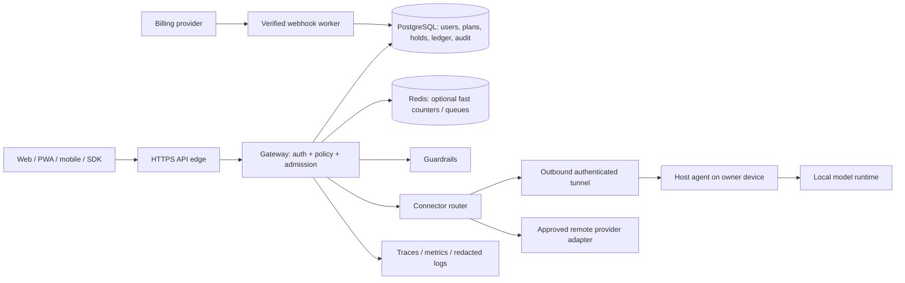
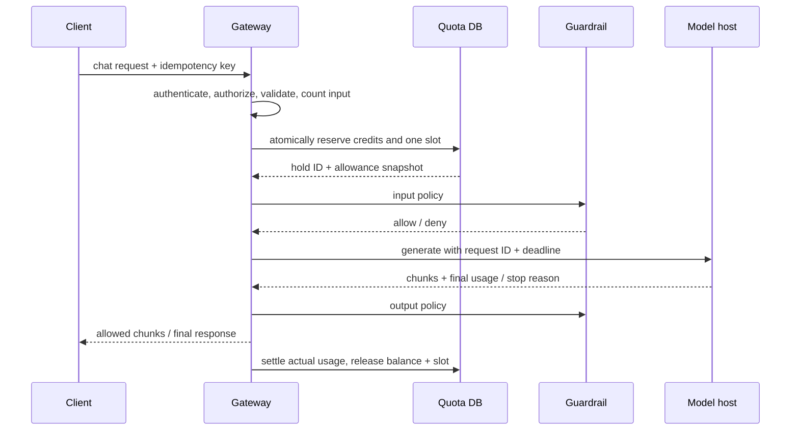

# Model Gateway: reusable API for a model hosted on one device

**Status:** architecture proposal, 29 October 2026, now moving into implementation on branch `model-gateway`. The gateway foundation (errors, adapters, quota, auth, router, admin, billing webhook, database store tier) and the browser gateway client are implemented; the in-process stores still back local development until the PostgreSQL wiring lands. The legacy Streamlit and CLI chat implementations and the browser model worker have been removed. The browser interface remains a gateway client with local chat history.

## 1. Product boundary and decisions

An organization connects one or more models that it runs on a laptop, server, private network, or external provider. Its users sign in to a web or mobile app, or call an API. A hosted **gateway** owns authentication, model access, plans, limits, metering, billing state, safety policy, and audit history. The model host only runs inference. Model weights need not leave the owner's device. Prompts and outputs necessarily reach the selected model host, so the owner must be trusted with that data.

The first deployment can expose **one model on one device**. The same protocol supports more hosts later. A static frontend can be hosted separately; the gateway and its durable database must remain available for accounts, quotas, and revocation. A phone, PWA, or browser is a client, not the quota authority.

The wrapper is protocol-agnostic, not magically compatible with every model. A deployment must implement the adapter contract below, declare its capabilities, and provide a reliable token counter. A model that cannot chat, report usage, or stop generation needs an explicit capability restriction or a custom adapter.

### Actors

| Actor | Responsibility |
| --- | --- |
| Platform operator | Runs the gateway, database, billing integration, monitoring, and incident response. |
| Organization owner | Connects a model host, chooses plan and policies, appoints admins. |
| Organization admin | Manages users, API keys, limits within delegated authority, and logs. |
| End user | Uses an allowed model through the app or a scoped API key. |
| Model host agent | Authenticates its device, advertises a deployment, executes requests, reports usage and health. |

An organization is the primary isolation boundary. A person may belong to several organizations; every request specifies one active organization. Limits can be enforced at organization, user, key, and model levels simultaneously.

## 2. System layout



**Control plane:** users, model registrations, policies, plans, keys, entitlements, and audit. **Data plane:** request validation, quota reservation, model invocation, output checks, streaming, and usage settlement. Separate services are optional at first; their responsibilities should still be distinct in code.

For a device behind NAT, the agent opens an outbound TLS connection to the gateway, authenticates with a device-bound credential, sends heartbeats, and receives work over that connection. No inbound port on the owner's home network is required. The gateway must never expose the runtime's unauthenticated local port to the internet. If the agent goes offline, requests fail with a clear `model_unavailable` response; they do not silently use another organization's model. On reconnect, the agent registers its exact deployment ID, model digest, tokenizer revision, capabilities, and capacity. An optional private-network connector can be used when the gateway and model are on the same trusted network.

The connector's transport may be a long-lived HTTP/2/WebSocket stream, a private tunnel, or a worker polling a queue. It needs message authentication, short-lived credentials, backpressure, cancellation, heartbeat expiry, and correlation IDs. The gateway routes only to an approved host ID; users cannot supply arbitrary URLs per request. vLLM offers an OpenAI-compatible server; llama.cpp has an OpenAI-compatible server; Ollama has its own chat endpoint and returns `prompt_eval_count` and `eval_count`. These are starting points for adapters, not a substitute for the gateway's authorization and quota logic. [vLLM serving](https://docs.vllm.ai/en/stable/serving/online_serving/openai_compatible_server/), [llama.cpp server](https://github.com/ggml-org/llama.cpp/blob/master/tools/server/README.md), [Ollama chat API](https://docs.ollama.com/api/chat).

### Model adapter contract

Each adapter implements `describe()`, `count_input(request)`, `generate(request, cancellation)`, `cancel(request_id)`, `normalize_usage(result)`, and `health()`. It must advertise:

| Capability | Required policy |
| --- | --- |
| Model ID, version/digest, tokenizer revision, context window | Pinned per request; reject if unknown or changed mid-request. |
| Chat, completion, embeddings, vision, tool calls, JSON mode | Enable only supported routes and validate modality-specific costs. |
| Streaming and cancellation | If cancellation is unsupported, keep accounting until the host finishes. |
| Authoritative usage | Prefer runtime counts; otherwise use a pinned tokenizer and mark usage `estimated`. |
| Input/output token weights | Versioned credit conversion per model. |
| Concurrent slots and queue depth | Protect a single CPU/GPU device from overload. |

The adapter maps a canonical gateway request to the runtime's format. Hidden prompts, chat templates, tools, images, and previous conversation turns count toward context and usage. An ordinary web client must not be able to override the system prompt or model options outside its allowed scope. vLLM defines model context with `--max-model-len` and can report token usage in a final streaming chunk when usage is requested; adapters must verify the actual runtime behavior for the pinned version. [vLLM serve options](https://docs.vllm.ai/en/latest/cli/serve/), [vLLM chat serving](https://docs.vllm.ai/en/latest/api/vllm/entrypoints/openai/chat_completion/serving/).

### Registering a host

1. Owner creates a one-time registration code in the admin console with a short expiry and intended organization.
2. Agent presents the code over TLS, receives a device identity, and binds a public key/certificate to the host record. Store the private key only on the device.
3. Agent probes its local runtime and reports immutable deployment metadata. Gateway verifies model ID, context, tokenizer, and endpoint allowlist; admin approves activation.
4. Agent renews short-lived authentication, heartbeats, and signs usage reports. A disconnected or revoked host stops receiving work.
5. Owner may drain a host before upgrade. A new model or tokenizer revision creates a **new deployment version** so old usage and in-flight requests remain attributable.

For remote HTTP providers, keep the provider credential in a secrets manager; the gateway calls a fixed, approved endpoint. Registration must validate DNS/IP ranges, redirects, TLS, and allowed ports to prevent server-side request forgery. Avoid fetching arbitrary model URLs supplied by an end user. SSRF and unrestricted resource consumption are recognized API risks. [OWASP API Security Top 10](https://api-security.owasp.org/editions/2023/en/0x11-t10/).

## 3. Identity, tenancy, and keys

Use a standard identity provider or email authentication with verified address, secure password reset, and MFA for owners/admins. Browser sessions use secure, HttpOnly, SameSite cookies with CSRF protection for state changes. SDKs use scoped API keys. Every authorization check resolves `organization_id`, `principal_id`, role, model grant, and key scopes server-side; a client-supplied ID alone grants nothing. Database queries must include the organization boundary, ideally backed by row-level policy or equivalent tests. Support staff access requires a time-limited, audited elevation.

Generate high-entropy random API keys, display them once, store only a prefix and keyed hash, and compare securely. Keys have owner, organization, scopes (`inference:chat`, `usage:read`, etc.), optional model restrictions, creation/expiry time, last-used timestamp, and `active/revoked/expired` state. Limit active keys per user and provide rotation with a short overlap window. Admin keys and device credentials are separate; never put a gateway master key or remote-provider secret in browser JavaScript, a mobile bundle, or Git. Secrets should be stored and rotated through a secrets-management system. [OWASP Secrets Management](https://cheatsheetseries.owasp.org/cheatsheets/Secrets_Management_Cheat_Sheet.html).

**Leak response:** integrate repository secret scanning, external leak notifications where available, unusual-use detection, and user reports. On a high-confidence match to a known key prefix/hash, atomically revoke the key, terminate or deny new sessions using it, notify the owner, and create an audit/incident record. A low-confidence signal can quarantine the key pending verification. Issue a replacement key only through an authenticated flow; never email the new secret. Automatic detection cannot discover every leak. A token found in a log must also trigger log redaction and retention review.

**User removal:** `suspend` denies new requests immediately and cancels queued jobs; the policy for active streams must be explicit (recommended: cancel them). `remove membership` revokes that organization's keys and access without destroying other organizations. `delete account` first handles open subscriptions, ownership transfer, privacy deletion, and legally required financial/audit retention. Prevent removal of the final owner/admin until another is assigned. A former user cannot recover private content through old conversation links.

## 4. Plans, quotas, and metering

Define plan versions, rather than editing historical limits in place. The owner can set **stricter organization caps** within the platform's purchased entitlement. Only the platform billing/admin role can raise purchased limits. Each model has a credit policy (for example, one input token = one credit, one output token = two credits). The UI should show both physical tokens and plan credits so users know what is being limited. Never use character count as if it were tokens.

An illustrative plan, with numbers for design discussion only:

| Limit | Free | Paid example | Scope |
| --- | ---: | ---: | --- |
| Rolling 5-hour credits | 10,000 | 200,000 | Per user |
| Calendar-month credits | 50,000 | 2,000,000 | Per user or organization, as configured |
| Requests/minute | 10 | 60 | Per key and user |
| Concurrent generations | 1 | 4 | Per user |
| Max output tokens/request | 256 | 2,048 | Per model and plan |

For a rolling 5-hour allowance, the exact definition is usage with timestamps in `(now - 5 hours, now]`; a new request becomes eligible as old usage ages out. For a calendar month, use a stored UTC billing anchor and actual month boundaries, not a 30-day approximation. A weekly limit must specify either rolling seven days or an anchored UTC week. Record the rule and timezone in the entitlement version. Show `remaining`, `reserved`, and `next reset` from the server. A rolling window has no single universal reset; report the earliest time enough credits become available or show an estimate. All applicable windows, plus lifetime/budget caps if configured, must pass.

Limits differ from charges. A request can consume tokens while failing to produce a useful answer; decide and disclose whether partial output is charged. Recommended policy: charge tokens actually processed, including partial output, but do not charge for requests rejected before model execution. Billing provider money events are separate from the token ledger. Cached input tokens and reasoning/tool tokens require explicit per-model rules; do not assume every runtime reports the same fields. Conversation history is re-sent and counted as input on every call. Truncation must be deterministic and visible, or reject with `context_limit_exceeded`; never silently omit required system instructions.

### Atomic request lifecycle



Recommended implementation uses a durable `usage_ledger` plus a `reservation` row. Under one database transaction, lock the applicable organization/user/key/model quota rows or use serializable isolation, check every window, insert a hold, and increment reserved counters. A single-host MVP can keep this entirely in PostgreSQL. Redis can later accelerate request-rate limits and queueing, but it must not become the only financial/accounting record. Never do a separate read-then-increment without an atomic guard.

```text
admit(request):
  identity = authenticate_and_authorize(request)
  deployment = resolve_approved_deployment(identity, request.model)
  idem = lookup_idempotency(identity, key, hash(request.body))
  if idem exists: return stored status/result or reconnect instruction
  input_tokens = deployment.adapter.count_input(full_effective_request)
  max_output = min(request.max_output, plan.max_output, model.max_output)
  require input_tokens + max_output <= deployment.context_window
  reserve_credits = price(input_tokens, max_output, deployment.credit_policy)
  transaction:
    lock all applicable quota rows in stable order
    require committed + held + reserve_credits <= each limit
    require active_slots < each concurrency limit
    create idempotency record, request, hold; increment held and slots
  run guardrails and model with bounded deadline
  settle once using authoritative or documented estimated usage
  release unused hold and active slot in the same transaction
```

Reservation for the full allowed output prevents concurrent requests from overspending a hard cap. For long generations, an alternative incremental lease can be used only if every chunk reserves its next tranche before generation continues; if quota is exhausted, stop cleanly. `max_output` must be bounded even when the client omits it. Scope the idempotency key to organization + principal + endpoint, bind it to a body hash, and reject reuse with different content. A duplicate request returns the original result/status and must not run inference again. Streaming replay is harder: keep a bounded event buffer with sequence IDs or return the final stored result after completion; document that exact mid-stream replay is not guaranteed.

**Settlement rules:** use the host's final input/output counts where trustworthy, validated against output and model bounds. For Ollama, normalize `prompt_eval_count` and `eval_count`; for OpenAI-style servers, normalize `usage.prompt_tokens` and `usage.completion_tokens`. If no final usage arrives, ask the host by request ID or count from pinned tokenizer and mark `estimated`. If the host may still be generating, retain the hold and slot until cancellation/timeout is confirmed; a reconciler resolves stale holds using host status, timeout, and an explicit conservative accounting rule. Never simply release all stale holds after a process crash, as that permits free inference. Ledger entries are append-only (`reserve`, `settle`, `release`, `adjustment`) with unique `request_id`/phase constraints. Correct errors with a compensating entry, not a rewrite. A nightly reconciliation compares host reports, gateway requests, ledger, and billing aggregates.

For a rolling window, settled usage and active holds must be evaluated with precise timestamps. A reservation that crosses a boundary remains attributed to its start window unless the plan explicitly says otherwise. UTC database time is authoritative; app servers and hosts do not decide resets. Decide how a plan change affects in-flight holds: recommended behavior is to finish under the entitlement version captured at admission; new requests use the new version. Suspending a user overrides this and cancels active work.

## 5. Billing and admin control

The billing provider is the payment source; the gateway database is the access-entitlement source after processing verified webhooks. Verify webhook signatures on the raw body, store event IDs uniquely, process duplicates idempotently, and fetch current subscription state if events arrive out of order. Stripe explicitly documents webhook signature verification and that event ordering is not guaranteed. [Stripe webhooks](https://docs.stripe.com/webhooks).

Define plan behavior in the product contract: upgrade effective immediately or at the next invoice; downgrade at period end; cancellation at paid-through date; failed payment with a finite grace period; dispute/chargeback with reviewed suspension; manual credit adjustment with actor/reason. Do not grant paid access merely because the checkout page returned success. Keep a ledger of entitlement versions and effective times. If billing is temporarily unavailable, continue using the last verified entitlement for a bounded grace period; do not invent a new payment status.

Admin console actions require role checks, CSRF protection, optimistic version checks, and audit entries containing actor, target, before/after values, reason, timestamp, and request ID. Support bulk suspend/revoke with confirmation and a dry-run preview. Changes to plan limits or credit weights are versioned and propagated to admission immediately; existing streams follow the captured version. Alert on unusual administrator changes, last-owner actions, and mass key revocations.

## 6. API contract

Version the public API (`/v1`) independently of internal agent protocol. Use one stable error envelope, request ID, and documented retry semantics.

| Endpoint | Purpose | Access |
| --- | --- | --- |
| `POST /v1/chat/completions` | Non-stream or SSE chat; `Idempotency-Key`; model and max output | User session or `inference:chat` key |
| `GET /v1/models` | Only deployments this principal may use, with capabilities | Signed-in principal |
| `GET /v1/usage` and `GET /v1/limits` | Settled/held credits, windows, reset/eligibility | User or scoped key |
| `POST/GET/DELETE /v1/keys` | Create/list/revoke personal API keys; value returned once | User session, MFA for sensitive scopes |
| `/v1/admin/users`, `/plans`, `/models`, `/policies`, `/audit` | Manage organization resources | Appropriate admin scope |
| `/internal/agents/register`, `/heartbeat`, `/work`, `/report` | Agent lifecycle and usage | Device identity only; separate network policy |
| `/webhooks/billing` | Payment events | Verified provider signature only |

Example request:

```http
POST /v1/chat/completions
Authorization: Bearer <user-api-key>
Idempotency-Key: 9f8d6f90-unique-per-intent
Content-Type: application/json

{"model":"org-model","messages":[{"role":"user","content":"Hello"}],"max_output_tokens":128,"stream":false}
```

Example final response (shape can be OpenAI-compatible with gateway additions):

```json
{
  "id": "req_01J...",
  "model": "org-model@deployment-7",
  "choices": [{"message": {"role": "assistant", "content": "Hello!"}, "finish_reason": "stop"}],
  "usage": {"input_tokens": 12, "output_tokens": 3, "total_tokens": 15, "credits": 18, "source": "model"},
  "quota": {"remaining_5h_credits": 9982, "reserved_credits": 0}
}
```

| Status | Stable code | Client action |
| --- | --- | --- |
| 400/422 | `invalid_request`, `unsupported_capability`, `context_limit_exceeded` | Fix request; do not retry unchanged. |
| 401/403 | `unauthenticated`, `forbidden`, `account_suspended`, `key_revoked` | Reauthenticate or contact admin. |
| 409 | `idempotency_conflict`, `deployment_changed` | Resolve request identity/version. |
| 413 | `payload_too_large` | Reduce body or attachments. |
| 429 | `quota_exceeded`, `rate_limited`, `concurrency_limit` | Honor `Retry-After` when present; show actual window. |
| 502/503/504 | `model_error`, `model_unavailable`, `model_timeout` | Bounded retry with same idempotency key. |

After SSE headers are sent, HTTP status cannot change. Send a final structured `error` or `done` event carrying request ID, usage status, and whether retry is safe. Never claim completion if the host stopped because of a token cap, disconnect, or guardrail. The UI can offer Continue as a **new, metered request** with explicit context and an idempotency key.

## 7. Data model and storage

| Table | Core fields and constraints |
| --- | --- |
| `organizations`, `users`, `memberships` | Unique IDs; membership role/status; no cross-tenant reference without matching org. |
| `model_hosts`, `deployments` | Org, device identity, status/last heartbeat, endpoint type, model/tokenizer digest, context/capabilities, immutable version. |
| `plans`, `entitlements`, `subscriptions` | Version, effective interval, scope, windows, weights, payment-state reference. |
| `api_keys`, `sessions` | Org/principal, hashed secret/prefix, scopes, expiry, revocation, last use. |
| `requests`, `idempotency_keys` | Request/body hash, principal, deployment, admission version, state, start/end, unique intent key. |
| `quota_holds`, `usage_ledger` | Hold amount/expiry/state; immutable debit/release/adjustment rows; unique settlement per request. |
| `guardrail_events`, `audit_events` | Policy version, decision, actor, request/trace ID, redacted metadata, retention class. |
| `webhook_events` | Provider event ID unique, signature result, processing state, related subscription. |

Use foreign keys and unique constraints; index `(organization_id, principal_id, created_at)` for usage and audit, `(status, expires_at)` for stale holds, and `(organization_id, key_prefix)` for key lookup. A prefix is an identifier, never authentication by itself. Keep raw conversations in a separate store only if the product promises server-side history. If chats stay browser-local, gateway accounting still stores metadata, never chat text by default. Private chat means no server-side chat history; inference still transmits text through the gateway and host, and mandatory security/usage metadata persists. State these semantics clearly to users.

## 8. Guardrails and privacy

Apply layered checks: schema and size validation; allowed roles/content types; prompt injection and tool-call controls; optional PII and content classification before forwarding; output checks before display; abuse detection across keys and accounts. Tool calling must use a separate permission broker with tool allowlists, argument validation, egress controls, timeouts, and per-tool audit. Model text never becomes an instruction to the gateway or a direct shell/database command. Guardrails reduce risk but cannot guarantee correct or safe answers. Keep model quality evaluation separate from policy enforcement; a gateway does not make a weak model factually accurate.

Streaming introduces a safety choice. For strict output moderation, buffer the full answer before release. For low-latency mode, hold back a bounded number of tokens/chunks and scan before release; a later rejection cannot retract text already shown. Record the chosen policy per organization and do not advertise strict moderation for an unbuffered stream. Decide whether blocked requests consume credits based on whether model computation already occurred.

Default logs contain request ID, org/user/key IDs (pseudonymous where possible), model/deployment, usage, latency, response status, policy decisions, and network metadata. Do **not** log prompt/response bodies or keys by default. Optional content logging requires an explicit tenant setting, encryption, access restrictions, retention period, deletion workflow, and clear user notice. Audit logs should be append-only and protected from ordinary admins; retention must meet local legal/contractual requirements without claiming indefinite storage. Encrypt traffic and disks, redact error messages, and propagate trace IDs across gateway and agent. OpenTelemetry can carry traces, metrics, and logs. [OpenTelemetry signals](https://opentelemetry.io/docs/concepts/signals/).

Operational metrics: time to first token, output tokens/second, queue wait, active slots, host heartbeat, model load failures, hold age, reconciliation differences, 4xx/5xx by code, guardrail blocks, billing webhook lag, and key-revocation latency. Alert on host offline, growing stale holds, quota mismatch, billing backlog, and sudden token spikes. Sample traces but retain complete accounting and security audit records.

## 9. Failure and abuse cases

| Case | Required behavior |
| --- | --- |
| Two requests race for last credits | Atomic reservation admits at most one; rejected request creates no charge. |
| Same request retried after timeout | Same idempotency key returns same result/status; different body gives conflict. |
| Client disconnects mid-stream | Signal cancellation to host; settle observed usage or reconcile; never assume zero. |
| Gateway crashes after reservation | Reconciler queries host by request ID, settles or releases by documented timeout rule. |
| Host finishes but final usage is lost | Use signed host report or pinned tokenizer estimate; flag for reconciliation. |
| Host keeps generating after client cancellation | Hold/slot remain until confirmed stopped; enforce deadline at agent. |
| Device offline or changes IP | Heartbeat expires; deny new work; outbound agent may reconnect with same identity. |
| Agent identity stolen/revoked | Revoke device cert; refuse work and rotate credentials; audit all affected requests. |
| CPU/GPU overloaded | Bounded queue and per-host slots; return `concurrency_limit` or `model_unavailable`. |
| Model process OOM/restart | Mark deployment unhealthy; settle processed tokens, release unused hold, retry only if safe. |
| Model/tokenizer changed | New deployment version; reject or drain incompatible in-flight work. |
| Input exceeds context/size | Reject before inference; count system, tools, attachments, and history. |
| Unsupported modality/tool request | Reject with capability error; do not coerce into misleading text. |
| 5-hour/month boundary or clock skew | UTC DB time and recorded rule/version determine attribution. |
| Plan upgrade/downgrade during generation | Existing request uses captured plan; future requests use new version. |
| Quota reduced below already spent | Block new requests; never retroactively delete ledger entries. |
| User suspended while streaming | Cancel active stream, deny next chunks and new work, settle actual usage. |
| Key rotated or leaked | New requests with old key fail after revocation; terminate active work per incident policy. |
| Billing webhook duplicate/out of order | Unique event ID; verify signature; reconcile against current provider state. |
| Payment provider unavailable | Use last verified entitlement for bounded grace; queue webhooks/reconcile later. |
| DB unavailable | Fail closed for admission and key/plan changes; do not infer free quota. |
| Redis unavailable | Fall back to DB-backed limits or fail closed; no unlimited bypass. |
| Log/telemetry sink unavailable | Buffer bounded metadata locally; keep accounting path durable; shed nonessential traces. |
| Malicious model-host endpoint URL | Register only approved destination; block private metadata IPs, redirects, and DNS rebinding. |
| Cross-tenant model ID or user ID guessed | Authorize every object against current org; return non-enumerating denial. |
| Browser key exposed in bundle | Never ship server or provider keys; revoke incident key, rotate, inspect usage. |
| Prompt injection asks for secrets/tools | Treat model output as untrusted; tool broker enforces permissions. |
| Guardrail fails or times out | Apply tenant policy: fail closed for regulated/strict route; explicitly defined fallback otherwise. |
| Output blocked after some chunks | Mark partial, stop host, settle usage, tell client content was interrupted. |
| Huge/invalid multipart or repeated signups | Body limits, rate limits, validation, verification, abuse controls before costly work. |
| Account deletion with unpaid invoice/audit | Remove access/content promptly; retain only required financial/security records. |
| Last organization owner deleted | Refuse until ownership is transferred or organization is closed. |
| Unknown actual token count | Mark estimate, retain evidence, reconcile; cap uncertainty and surface it in usage UI. |
| Duplicate host report or double settlement | Unique request/phase constraints and idempotent transaction. |
| Client asks to Continue | New request with prior context; metered normally; no hidden infinite loop. |

## 10. Deployment and delivery plan

**MVP:** one gateway service, PostgreSQL, one outbound host agent, one OpenAI-compatible adapter, web session login, scoped API keys, free/paid entitlement records, hard quota reservation, usage ledger, admin suspend/revoke, redacted audit logs, and a simple chat client. Start with a single modest model and a maximum of one active generation if the device is CPU-bound. The model host can use vLLM where hardware/runtime support it, or llama.cpp/Ollama when that better fits the device. Do not select a serving engine solely because its API is familiar; benchmark on the actual device. vLLM documents CPU support separately from GPU serving. [vLLM CPU installation](https://docs.vllm.ai/en/latest/getting_started/installation/cpu/).

**Production hardening:** verified payment webhooks, MFA for admins, secret manager, device identity rotation, SSE replay/terminal events, reconciliation worker, guardrail policy versions, monitoring, backups and restore drills, key leak workflow, disaster recovery, load tests, and tenant-isolation tests. Add Redis only when measured latency/traffic justifies it; PostgreSQL remains accounting truth. Multi-host scheduling and failover are a later feature. A single physical model host remains a single point of failure unless another host is added.

**Migration from this repository:** the browser interface now calls the gateway and retains browser-local chats. The old local model paths and SQLite chat storage have been removed. Optional cloud chat sync requires a separate encrypted conversation service and consent. Never embed the owner's model or provider secret in frontend code.

### Acceptance tests before launch

1. With one credit left, concurrent requests cannot spend more than the cap; 5-hour and monthly windows show consistent remaining balances.
2. A lost connection, retry, host crash, and gateway crash never yield duplicate inference/settlement or permanent orphan holds.
3. A revoked key, suspended user, or disconnected host is denied within the documented propagation time.
4. Cross-organization IDs, guessed chat links, and API-key scope escalation reveal no data or model access.
5. Partial streams, missing usage, context overflow, and model stop reasons produce accurate user-visible status and ledger entries.
6. Duplicate and out-of-order payment webhooks produce the same final entitlement as the provider's current subscription state.
7. Prompt/output bodies and secrets are absent from default logs; optional content logging honors retention/deletion.
8. Backup restore reconstructs entitlements, active key state, and usage ledger; a reconciliation run detects deliberate count mismatches.

## 11. Product decisions still needed

Before coding, owner/platform must decide: whether plans are per user or pooled per organization; exact 5-hour and weekly window definitions; free and paid credit amounts; input/output weights and treatment of cache/reasoning tokens; whether partial work is charged; upgrade/downgrade/grace policy; supported modalities and adapters; whether strict moderation may delay streaming; whether cloud chat history exists; retention and regional hosting requirements; and the maximum tolerated downtime of a single model device. Record each decision in a versioned policy so usage can be explained later.
